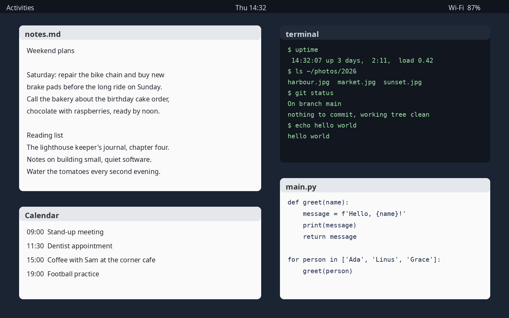

# GlitchCrypt

A Wayland screensaver that **encrypts the text on your screen**.

When your machine goes idle, GlitchCrypt takes a snapshot of the screen and runs
OCR on it to find every line of text. Then it opens straight into a coarse,
dark, tinted, scanlined ghost of your desktop, where every line is already
cipher glyphs that keep reshuffling. Every few seconds a short
RGB-split slice glitch tears across the screen. It's calm on purpose:
slow-moving, not a strobe.

The glyphs are random, so they can't be decoded back into your text, and the
background is reduced so far that even text OCR missed can't be recovered.
Only the rough layout of your screen shows through. See [Privacy](#privacy).

| Before | After |
|---|---|
|  |  |

*(The demo uses a made-up desktop drawn by [`docs/make-demo.py`](docs/make-demo.py).)*

> **Not a lock screen.** Any key, click or mouse move closes it and shows
> your desktop again. Keep using your normal screen locker. GlitchCrypt runs
> before it.

## Requirements

- A Wayland compositor that [`grim`](https://sr.ht/~emersion/grim/) can capture,
  i.e. one with wlr-screencopy: niri, Sway, Hyprland, river, Wayfire and others.
  GNOME and KDE Plasma don't support it.
- `python3` with `pygame` and `Pillow`
- `tesseract` (with English data) for OCR
- `swayidle` for the idle trigger

```sh
# Debian / Ubuntu
sudo apt install python3-pygame python3-pil tesseract-ocr grim swayidle
# Arch
sudo pacman -S python-pygame python-pillow tesseract tesseract-data-eng grim swayidle
# Fedora
sudo dnf install python3-pygame python3-pillow tesseract grim swayidle
```

## Install

```sh
git clone <this repo> && cd GlitchCrypt
./install.sh --enable
```

This installs `~/.local/bin/glitchcrypt` and a systemd user service,
`glitchcrypt.service`. The service runs `swayidle` to start GlitchCrypt after
**3 minutes** idle and stops it as soon as you're back. To change the delay,
edit `timeout 180` in `~/.config/systemd/user/glitchcrypt.service`. Keep it
shorter than your lock or screen-off timeout. Then run
`systemctl --user daemon-reload && systemctl --user restart glitchcrypt`.

The service is `WantedBy=graphical-session.target`, which niri, Sway (via
`sway-systemd` or uwsm) and Hyprland (via uwsm) all start. If your session
doesn't, start it from your compositor's autostart instead.

Uninstall with `./install.sh --uninstall`.

## Usage

```sh
glitchcrypt                    # run now, until a key, click or mouse move
glitchcrypt --seconds 15       # preview for 15 s
glitchcrypt --tint '#ff6ac1'   # pink instead of the default blue
glitchcrypt --image shot.png --output out.png   # render offscreen to a PNG
```

| Option | Default | |
|---|---|---|
| `--tint HEX` | `#a9c7ff` | Colour of the tint and the glyphs |
| `--font FILE` | fontconfig `monospace:bold` | Font for the glyphs |
| `--fps N` | `12` | Frame rate |
| `--image FILE` | screen snapshot | Use an image instead of the screen |
| `--seconds N` | until input | Quit after N seconds |
| `--output PNG` | | Render offscreen and save the last frame |

To change the behaviour, edit the constants at the top of `glitchcrypt`:
`SCRAMBLE_RATE` (how fast glyphs change), `GRID_ROWS` / `LEVELS` (background
coarseness; raising them reveals more of your screen),
`GLITCH_EVERY` (the slice glitch interval), `GLYPHS` (the cipher alphabet) and
others.

## Privacy

GlitchCrypt is built to show as little of your screen as possible:

- **Nothing is written to disk.** The snapshot goes from `grim` into memory
  and on to tesseract through a pipe, with no temporary files.
- **Nothing is derived from your text.** The recognised text is thrown away
  at once. Words are merged into whole lines, and each line is widened to a
  coarse grid, so neither word lengths nor exact line lengths show. The
  glyphs are random.
- **The real screen is never shown, not even blurred.** Blurring isn't
  redaction: it can be partly reversed by deconvolution, and blurred text can
  be matched by blurring guesses the same way. GlitchCrypt instead averages
  the screen down to a grid 45 cells tall, so each cell is taller than a
  line of text and several characters wide. It then quantises every cell to
  one of 4 grey levels with random dither. That throws the detail away for good: about 2 bits per cell
  survive, which is enough to show "something is here" but nowhere near
  enough to hold text. OCR finishes before the window opens, so the very
  first frame is already fully encrypted.
- **Its memory stays private.** It disables core dumps and marks itself
  non-dumpable, so other unprivileged processes can't attach to it or read
  its memory.
- **Nothing goes over the network.**

What's left visible: the rough layout of your screen (where windows and
blocks of text are, at grid resolution), the vertical position and height of
each text line, and roughly how long each line is, to within a grid cell.
Not a single character survives.

## How it works

1. `grim` captures the screen as PPM. That's fast, and it works even with
   grim builds that lack JPEG support.
2. `tesseract --psm 11` (sparse text) reads a grayscale copy from stdin and
   returns word boxes as TSV, which are merged into lines and snapped to the
   grid. This takes a second or two, and the window only opens once it's done.
3. pygame draws a fullscreen window. Each frame it shows the coarse, tinted
   background, fills each line box with the background colour and draws the
   cipher glyphs sized to the box. Every few seconds it blends in an
   RGB-split copy of a few slices of the screen.

## License

GPL-3.0-or-later. See [LICENSE](LICENSE).
