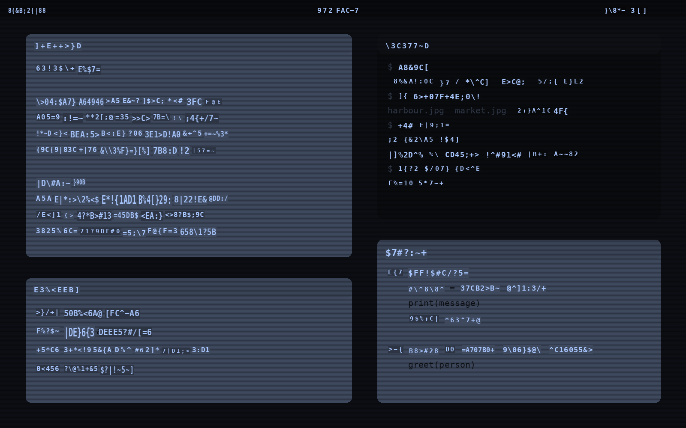

# GlitchCrypt

A Wayland screensaver that **encrypts the text on your screen**.

When your machine goes idle, GlitchCrypt takes a snapshot of the screen and runs
OCR on it to find every word. It fades into a dark, tinted, scanlined copy of
your desktop, then sweeps from top to bottom, turning each word into cipher
glyphs that keep reshuffling. Now and then a word briefly decrypts back to
plain text, and every few seconds a short RGB-split slice glitch tears across
the screen. It's calm on purpose: slow-moving, not a strobe.

| Before | After |
|---|---|
|  |  |

*(The demo uses a made-up desktop drawn by [`docs/make-demo.py`](docs/make-demo.py).)*

> **Not a lock screen.** The real text is still on your machine and words
> decrypt on purpose. Keep using your normal screen locker. GlitchCrypt is
> eye candy that runs before it.

## Requirements

- A Wayland compositor that [`grim`](https://sr.ht/~emersion/grim/) can capture,
  i.e. one with wlr-screencopy: niri, Sway, Hyprland, river, Wayfire and others.
  GNOME and KDE Plasma don't support it.
- `python3` with `pygame` and `Pillow`
- `tesseract` (with English data) for OCR
- `swayidle` for the idle trigger

```sh
# Debian / Ubuntu
sudo apt install python3-pygame python3-pil tesseract-ocr grim swayidle
# Arch
sudo pacman -S python-pygame python-pillow tesseract tesseract-data-eng grim swayidle
# Fedora
sudo dnf install python3-pygame python3-pillow tesseract grim swayidle
```

## Install

```sh
git clone <this repo> && cd GlitchCrypt
./install.sh --enable
```

This installs `~/.local/bin/glitchcrypt` and a systemd user service,
`glitchcrypt.service`. The service runs `swayidle` to start GlitchCrypt after
**3 minutes** idle and stops it as soon as you're back. To change the delay,
edit `timeout 180` in `~/.config/systemd/user/glitchcrypt.service`. Keep it
shorter than your lock or screen-off timeout. Then run
`systemctl --user daemon-reload && systemctl --user restart glitchcrypt`.

The service is `WantedBy=graphical-session.target`, which niri, Sway (via
`sway-systemd` or uwsm) and Hyprland (via uwsm) all start. If your session
doesn't, start it from your compositor's autostart instead.

Uninstall with `./install.sh --uninstall`.

## Usage

```sh
glitchcrypt                    # run now, until a key, click or mouse move
glitchcrypt --seconds 15       # preview for 15 s
glitchcrypt --tint '#ff6ac1'   # pink instead of the default blue
glitchcrypt --image shot.png --output out.png   # render offscreen to a PNG
```

| Option | Default | |
|---|---|---|
| `--tint HEX` | `#a9c7ff` | Colour of the tint and the glyphs |
| `--font FILE` | fontconfig `monospace:bold` | Font for the glyphs |
| `--fps N` | `12` | Frame rate |
| `--image FILE` | screen snapshot | Use an image instead of the screen |
| `--seconds N` | until input | Quit after N seconds |
| `--output PNG` | | Render offscreen and save the last frame |

To change the behaviour, edit the constants at the top of `glitchcrypt`:
`SCRAMBLE_RATE` (how fast glyphs change), `REVEAL_CHANCE` / `REVEAL_TIME` (how
often and how long words decrypt), `GLITCH_EVERY` (the slice glitch interval),
`GLYPHS` (the cipher alphabet) and others.

## Privacy

Everything stays on your machine. The snapshot is written to
`$XDG_RUNTIME_DIR`, a private tmpfs, only so tesseract can read it, and it's
deleted when GlitchCrypt exits. Nothing goes over the network.

## How it works

1. `grim` captures the screen as PPM. That's fast, and it works even with
   grim builds that lack JPEG support.
2. `tesseract --psm 11` (sparse text) returns word boxes as TSV. This runs in
   a background thread while the 1.5 s fade-in plays.
3. pygame draws a fullscreen window. Each frame it shows the filtered
   snapshot, fills each word box with the background colour and draws the
   cipher glyphs sized to the box. Every few seconds it blends in an
   RGB-split copy of a few slices of the screen.

## License

GPL-3.0-or-later. See [LICENSE](LICENSE).
